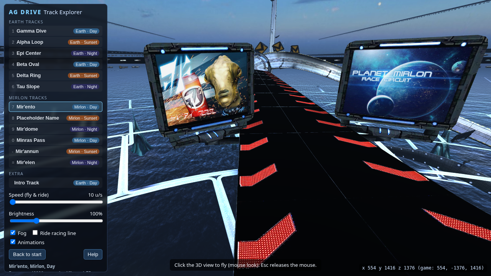

# AG Drive Explorer

AG Drive Explorer turns your own copy of the iOS racing game **AG Drive 1.4.5** into a 3D track explorer that runs in a web browser.
A small Windows converter reads the game's `.ipa` file and decodes its track geometry, textures, skyboxes, animations and lighting settings.
It then writes a self-contained folder with a three.js viewer: you can fly freely around every track, ride the racing line, and watch the
animated world.



## Features

- **All 13 tracks**: the 12 race tracks on Earth and Mirlon, plus the menu intro track
- **Per-track skyboxes, fog and lighting** taken from each track's own settings: sun direction and colour, fog range and colours, and baked lighting
- **Free-fly camera** with mouse look and a speed slider (10 to 30,000 units/s)
- **Racing-line ride**: follows the game's own racing line on a smooth spline, banking and rolling with the track
- **Animations**: flying ships, moving towers and other animated objects, scrolling traffic lanes, and cycling ad screens
- **Track switcher**: a labelled list grouped by planet, with number-key shortcuts
- Standard glTF 2.0 output (meshopt-compressed GLB + WebP textures) that also opens in other glTF tools

> **No game content is included.** This repository and the release executable contain only original code and open-source
> libraries. No game assets, game code or data copied from the game are included. Everything is read at run time from a copy of the
> game that **you supply**, so you need your own legally obtained copy.

## Requirements

- The **iOS `.ipa` of AG Drive, version 1.4.5** (ZORG Entertainment).
  - It must be the **iOS IPA**, and it must be **decrypted**. Encrypted App Store IPAs, Android APKs and other game versions will not work.
    The converter checks the bundle id and version and tells you if the file isn't the right one.
- Windows 10 or 11 (64-bit) for the ready-made converter. For other systems, see [Building from source](#building-from-source-with-python-optional).
- A current desktop browser with WebGL 2 (Chrome, Edge, Firefox or Safari) to view the result.

## Quick start (Windows)

1. Download **`AGDriveConverter.exe`** from the [Releases](../../releases) page.
2. Run it. The exe isn't code-signed, so Windows SmartScreen may show "Windows protected your PC". Click **More info**, then **Run anyway**.
3. Click **Choose IPA…** and select your AG Drive 1.4.5 `.ipa`. You can also drag the `.ipa` into the window, or onto the exe's icon.
4. Click **Convert**. It takes about one to two minutes. By default the output goes to an `AGDrive_Explorer` folder next to the `.ipa`.
5. Click **Open folder**, then start the explorer:
   - Windows: double-click **`start.bat`**
   - macOS: double-click **`start.command`** (the first time, right-click it, choose Open, then confirm)
   - Linux: run **`./start.sh`**

   Your browser opens the explorer at `http://127.0.0.1:8642/`. Keep the small server window open while you explore.

The generated folder is portable: you can copy it to another computer. Running the start script there needs Python 3; on Windows it falls back to PowerShell if Python isn't installed.

## Explorer controls

| Input | Action |
|---|---|
| Click the 3D view | Capture the mouse for mouse-look (**Esc** releases it) |
| Drag | Look around without capturing the mouse |
| **W A S D** / arrow keys | Fly forward / left / back / right |
| **Space** or **E** | Fly up |
| **C** or **Q** | Fly down |
| **Shift** (hold) | Boost ×5 |
| Mouse wheel / *Speed* slider | Fly and ride speed, 10 to 30,000 units/s |
| **R** / *Back to start* | Return to the start line |
| **F** / *Ride racing line* | Ride the racing line at the slider speed. The camera banks with the track, and the mouse looks around |
| **V** | While riding, look straight ahead again |
| **N** / *Animations* | Turn the animations on or off |
| **G** / *Fog* | Toggle fog |
| **[** **]** or **PgUp** / **PgDn** | Previous / next track |
| **1–9, 0, -, =** | Jump straight to track 1–12 |
| **H** / *Help* | Show the controls |

*Brightness* scales the final image if a track looks too dark or too bright on your screen. You can link straight to a track with
its id in the URL, for example `http://127.0.0.1:8642/#track_mirlon_03`.

## Command-line usage

```
AGDriveConverter.exe path\to\agdrive.ipa [output_folder]
```

- With only the `.ipa`, the output goes to `AGDrive_Explorer` next to it.
- Add `--cli` to force console mode or `--gui` to force the window. Exit code 0 means success, and 2 means the input was rejected (for example, the wrong game or version).
- If no console is attached, the log is written to `%TEMP%\AGDriveConverter.log`.

## Output folder layout

```
AGDrive_Explorer/
├─ index.html, style.css, js/        the explorer (three.js r170 in vendor/)
├─ start.bat / start.command / start.sh, serve.py, serve.ps1   local web server launchers
├─ README.md                         controls and the list of converted tracks
└─ assets/
   ├─ tracks.json                    track list, fog / sun / lighting settings
   ├─ shader_params.json             shader constants read from the game's shader scripts
   ├─ tracks/   *.glb                track geometry (glTF 2.0, meshopt-compressed, Y-up)
   ├─ textures/ *.webp               track textures
   ├─ sky/                           skybox faces (.jpg) and reflection cubemaps (.png)
   └─ anim/     *.json + *.bin       racing lines and object animation keyframes
```

## Troubleshooting

| Problem | Fix |
|---|---|
| "This IPA is not AG Drive" / "The converter only supports version 1.4.5" | The file is a different app or game version. Use the iOS IPA of AG Drive 1.4.5. |
| "not a valid IPA (zip) archive" | The download is incomplete or isn't an IPA. Download it again. |
| Conversion fails on encrypted data or garbled files | The IPA is still App Store-encrypted. Use a decrypted IPA. |
| SmartScreen or antivirus blocks the exe | The exe is unsigned. Use **More info → Run anyway**, or build it yourself from source. One-file PyInstaller apps sometimes trigger false positives. |
| "The output folder already contains other files" | Choose an empty folder. The converter only overwrites folders that it generated itself. |
| A blank page, or "Could not load assets/tracks.json" | Start the explorer with a start script. Opening `index.html` directly from disk is blocked by browsers. |
| A black or empty 3D view, or WebGL errors in the browser console | Update your browser or graphics driver, and enable hardware acceleration. |
| A port is already in use | The server automatically tries the next free port. Check the console window for the address. |

## How it works

- `agdconv/pipeline.py` opens the `.ipa` as a zip (nothing is fully extracted) and checks `Info.plist` for the bundle id and version.
- `agdconv/luac52.py` is a minimal Lua 5.2 bytecode reader. It evaluates the game's precompiled track-settings scripts to get
  values such as fog, sun position and lighting coefficients. No Lua runtime or decompiler is involved.
- `agdconv/formats.py`, `texdec.py` and `glb.py` parse the IonCore engine formats and write the output:
  - STG1 geometry, `.aga` animation and IPK2 script archives
  - LZ4 + PVRTC textures
  - glTF, converting Z-up to Y-up, flipping the triangle winding to counter-clockwise and making texture V top-down
- gltfpack (meshoptimizer) compresses the meshes, and Pillow writes the WebP textures.
- The viewer re-implements the game's environment shaders (baked lighting, reflections, fog, scrolling traffic, water) in three.js.

## Disclaimer

This is an unofficial fan project for personal, non-commercial exploration of a game you own. It is not affiliated with, endorsed by or
connected to ZORG Entertainment. "AG Drive" and all related names, logos and trademarks belong to their respective owners. Please
respect the game's licence and don't distribute converted game content.

This project was made with the help of [Grok](https://grok.com).

## Licence

The code in this repository is released under the [MIT License](LICENSE), © 2026 AgiLityOps.
Third-party components keep their own licences. See [THIRD_PARTY_NOTICES.md](THIRD_PARTY_NOTICES.md).

---

## Building from source with Python (optional)

You don't need this if you use the release exe.

1. Install **Python 3.10 or newer** (tested with 3.12), including tkinter for the GUI.
2. Install the dependencies:
   ```
   pip install -r requirements.txt
   ```
   (`tkinterdnd2` is optional. It only adds drag-and-drop into the window.)
3. Get **gltfpack** from the [meshoptimizer releases](https://github.com/zeux/meshoptimizer/releases) (tested with v1.3).
   Put the binary in `bin/` (`bin/gltfpack.exe` on Windows, `bin/gltfpack` on macOS/Linux) or anywhere on your `PATH`.
4. Run the converter:
   ```
   python AGDriveConverter.py path/to/agdrive.ipa [output_folder]
   ```
   Or run `python AGDriveConverter.py` with no arguments to open the GUI.

### Building the Windows exe

On Windows, with the dependencies above plus `pip install pyinstaller` and `bin\gltfpack.exe` in place:

```
pyinstaller --noconfirm --clean AGDriveConverter.spec
```

The one-file exe appears in `dist\AGDriveConverter.exe`.

On Linux, `build_exe.sh` does the same with Windows Python running under **Wine** (the one-time setup steps are in the script header).
It downloads `gltfpack.exe` automatically.
